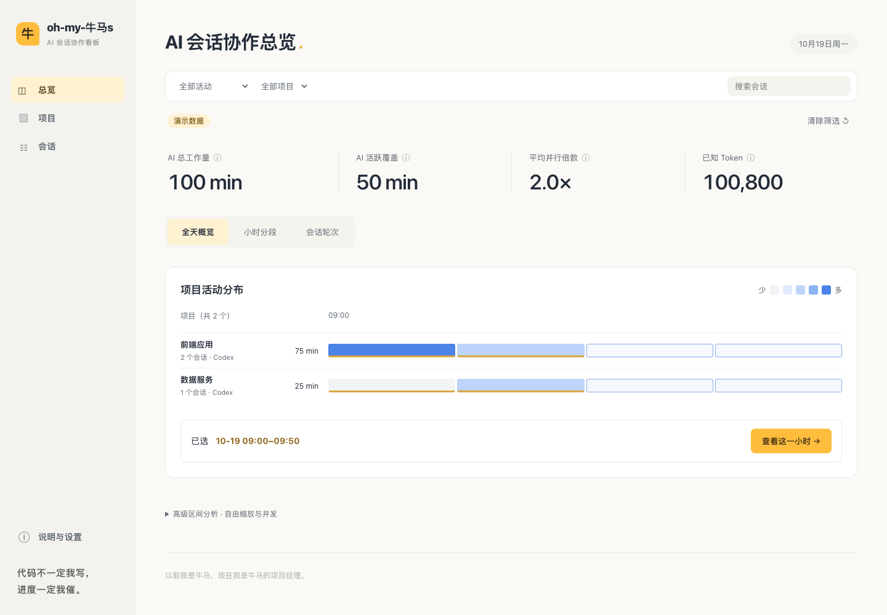
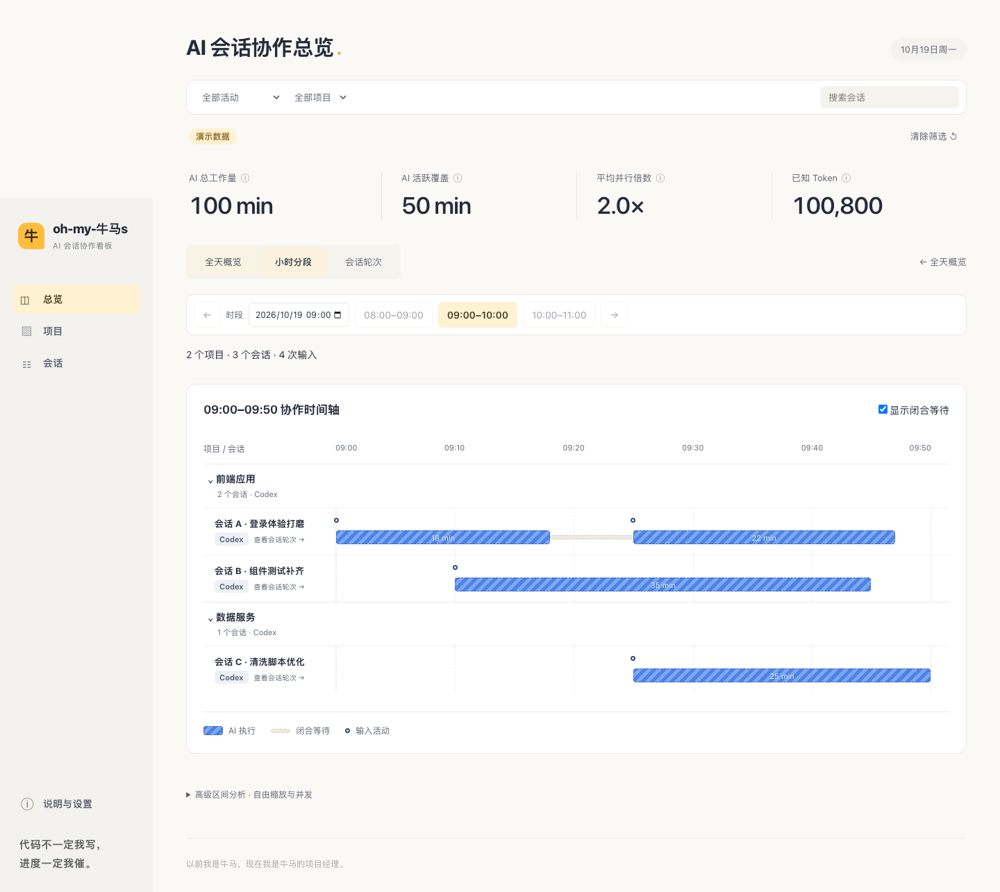
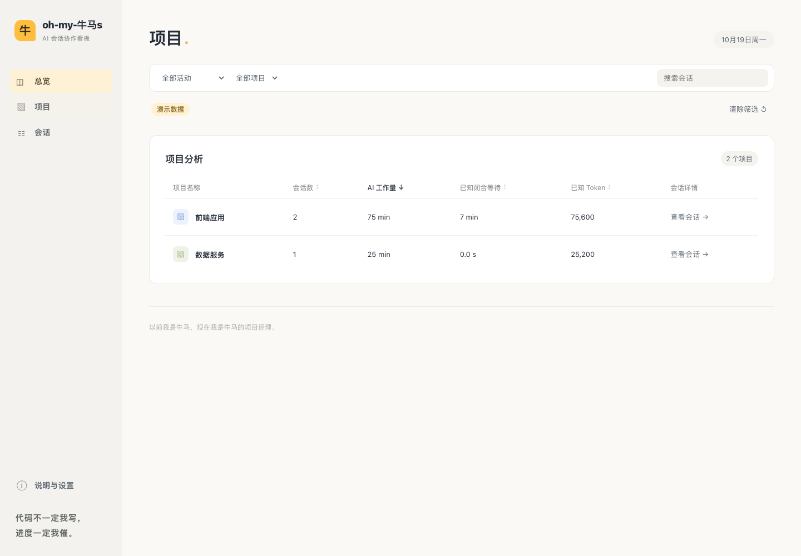
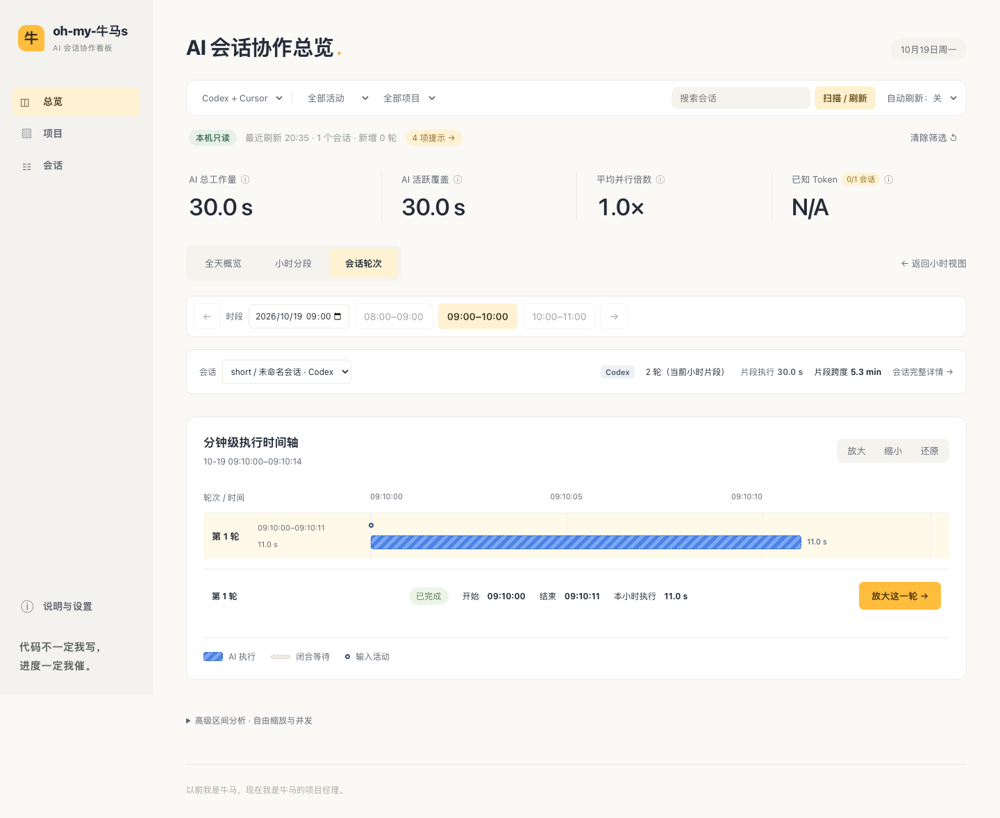

# 🐮 oh-my-牛马s

### The AI Agent Herding Dashboard

**I used to do the work. Now I manage the herd.**<br>
**Stop coding. Start herding.**

[English](README.md) · [简体中文](README_zh.md) · [Technical guide](docs/TECHNICAL.md) · [Contributing](CONTRIBUTING.md)

A local-first dashboard for developers working with several AI sessions at once. Bring **Codex and Cursor** into one view, follow overlapping work on a shared timeline, and understand how your day with AI actually unfolded.

> “Niu ma” (牛马, literally “cattle and horses”) is Chinese internet slang for an overworked worker. Here, the joke is on us: we finally got AI to do the work—and became project managers.



*Actual application, synthetic demo data. The interface is currently in Simplified Chinese; an English UI is on the roadmap.*

## Why this exists

You ask one session to build a feature, another to fix a bug, and a third to review the result. Then you spend the afternoon switching tabs, checking what finished, and remembering where to reply.

A chat history tells you what was said. A token counter tells you how much was used. **This dashboard puts the rhythm of collaboration on a clock:** when sessions overlapped, where work paused, and how separate conversations added up across projects.

| The everyday frustration | What you get |
| --- | --- |
| Work is scattered across Codex, Cursor, and different projects. | One workspace with shared date, project, source, and search filters. |
| A conversation stayed open all day. How long did AI actually work? | Execution time and conversation span shown separately, with coverage and uncertainty. |
| Several sessions ran together, but the overlap is hard to see. | A shared timeline, active coverage, average parallelism, and peak concurrency. |
| A whole day of tiny execution bars becomes unreadable. | Start with the day, open an hour, then zoom into an individual turn. |
| Useful analytics seem to require uploading private conversations. | Read-only local imports and a local metadata cache. No cloud account or API key required. |

## The satisfying part

### See the whole day, then find the moment

The timeline is the heart of the product: **daily project activity → hourly session collaboration → individual turns**. Follow a busy patch into an hour, open a session, and zoom a short response down to seconds. Your headline totals stay anchored to the selected date range while you explore.



*Execution, input activity, and closed waits have separate visual meanings. Waiting is shown only where the source supports it.*

### Feel the parallelism

Three sessions can produce **100 minutes of AI work in 50 minutes of active wall-clock time**. The demo makes that relationship visible: 100 minutes of workload, 50 minutes of coverage, and 2.0× average parallelism. It is a way to understand overlap, rather than a productivity score.

### Make the workspace yours

Give projects readable aliases, merge related directories into one project, restore their original grouping, and add searchable session notes. Your labels survive refreshes and restarts. Optional 15 / 30 / 60-second refresh keeps local activity up to date while the page is visible.

<details>
<summary>More of the working product: projects and a single-turn close-up</summary>





These screenshots also use synthetic data, including the isolated test import shown as “local data.” No private session titles or conversations are included.

</details>

## Try it locally

Requires **Node.js 24.11+**. macOS is the currently verified platform for local imports.

```sh
git clone https://github.com/atom077/oh-my-niumas.git
cd oh-my-niumas
nvm install
nvm use
npm ci
npm start
```

Open **[http://127.0.0.1:4317/?source=demo](http://127.0.0.1:4317/?source=demo)** for the built-in three-session demo. No existing AI history is needed.

To explore your own history, switch **数据来源 → 本机数据** (Data source → Local data), then click **扫描 / 刷新** (Scan / Refresh). You can filter Codex, Cursor, or both. After your first scan, the regular home URL prefers your available local data.

Configuration, development commands, platform notes, and troubleshooting live in the **[technical guide](docs/TECHNICAL.md)**.

## Private by design, honest about the numbers

Imports read your local AI history without modifying it. Computation and the metadata cache stay on your machine; raw prompts, tool output, and full filesystem paths are kept out of the cache and dashboard API. Existing session titles are displayed locally from indexes and kept in memory. The service binds to loopback.

Codex timing comes from supported log boundaries. **Cursor execution intervals are inferred** only when local timing records pass consistency checks, and are labeled accordingly; other turns retain recorded durations or unknown activity. Cursor does not record real token usage locally, so **token figures are not shown for Cursor sessions**; token metrics cover Codex only. Coverage and concurrency use locatable intervals, including labeled inferences.

Waiting for your next input is not your working time. A long conversation is not continuous AI execution. Missing evidence stays missing. See [sources, formulas, and limitations](docs/TECHNICAL.md#data-and-metric-contracts).

## Where we are going

The vision is a **personal flight recorder for working with a team of AI agents**: understand the work, the handoffs, and your own coordination patterns across tools, with enough context to trust what you see.

The current early release includes three analysis pages (overview with the timeline, projects, sessions) plus an explanations & settings page, lists sortable by AI execution time, Codex and Cursor local imports, the three-level timeline, project organization, session notes, and optional automatic refresh. The next steps are proposals, with priority shaped by actual use:

- [ ] **Polish daily use:** clearer dense timelines, large-history performance, and a smoother first scan.
- [ ] **English interface and broader platform validation:** make the experience easier to use beyond the current macOS / Chinese UI setup.
- [ ] **Weekly collaboration trends:** follow workload, known token usage, and parallelism over time.
- [ ] **Portable results:** CSV / JSON exports and shareable, sanitized summaries.
- [ ] **More agent sources:** investigate Claude Code and OpenCode after validating their local formats.
- [ ] **Deeper evidence:** broader log-version coverage, verified parent/sub-agent relationships, and tool timing where supported.

API-equivalent cost estimates may follow once pricing and model coverage can be made explicit. Human-effort estimation remains an optional research direction requiring a separate privacy decision. This release focuses on observation; agent control and orchestration are outside its current scope.

## Build with us

Useful contributions include feedback on the timeline, reproducible parser edge cases, accessibility improvements, translations, and new source adapters with documented evidence. Start with [CONTRIBUTING.md](CONTRIBUTING.md), and use **synthetic or carefully sanitized examples** when opening an [issue](https://github.com/atom077/oh-my-niumas/issues).

For architecture, metric definitions, source findings, and verification records, see the [technical guide](docs/TECHNICAL.md). The original [product and design brief](oh-my-niumas-project/PROJECT.md) includes early visual explorations, clearly separate from the working screenshots above.

## License

[MIT](LICENSE). Third-party packages retain their own [licenses and notices](THIRD_PARTY_NOTICES.md). Independently developed; not affiliated with OpenAI or Cursor.
