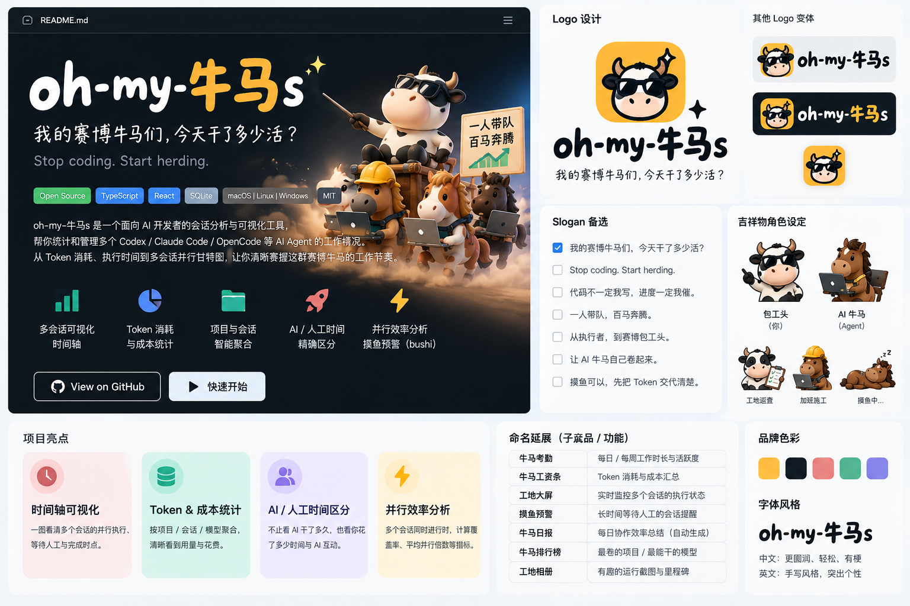
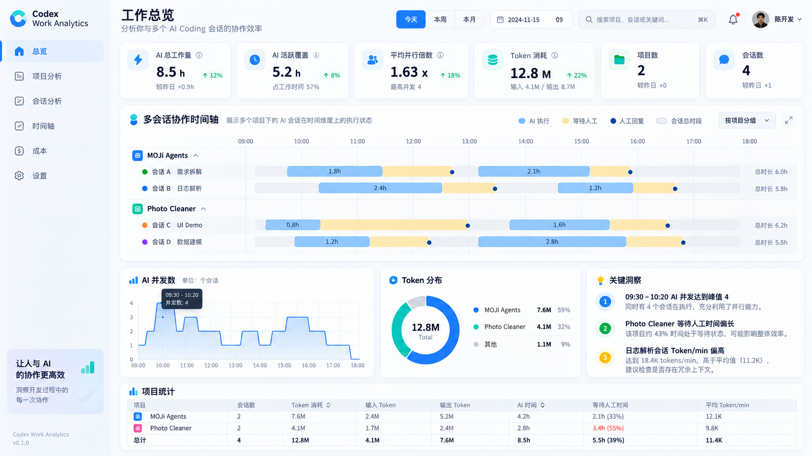
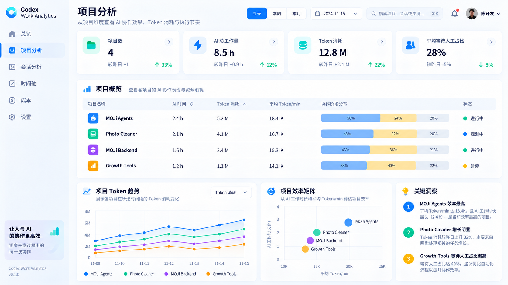
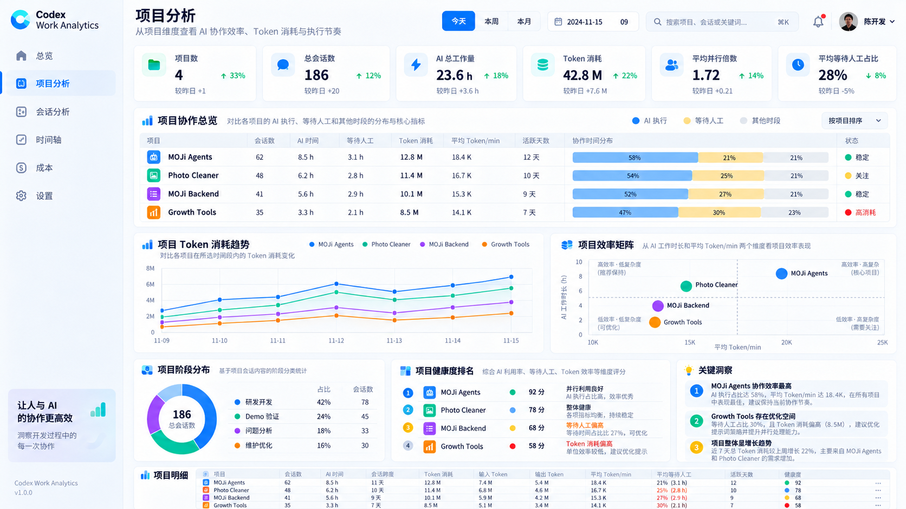
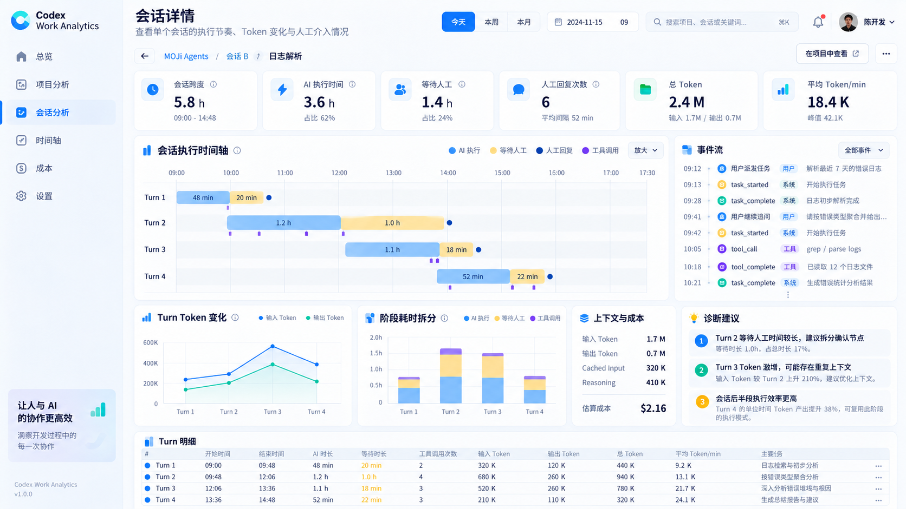
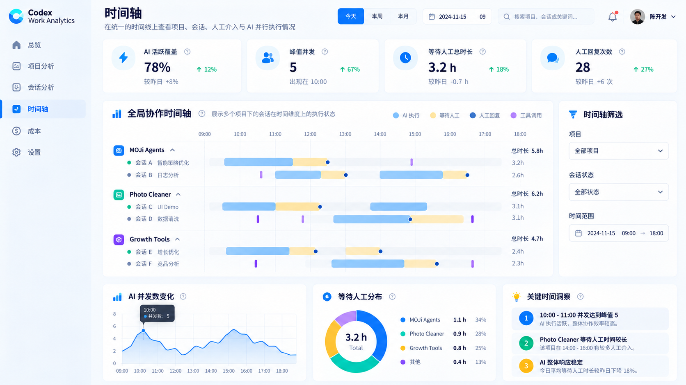
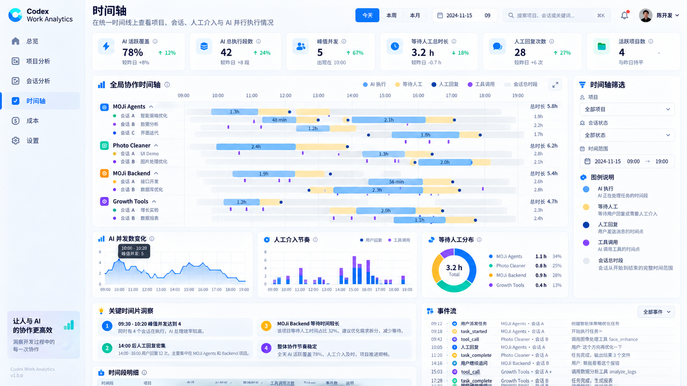

# 🐮 oh-my-牛马s

> **以前我是牛马，现在我是牛马的项目经理。**  
> **Stop coding. Start herding.**

**项目类型：** 开源、本地优先的 AI Agent 协作分析工具（规划 / 设计与 Demo 阶段）  
**英文描述：** The AI Agent Herding Dashboard  
**仓库候选名：** `oh-my-niumas`（可用性尚未验证）  
**日期：** 2026-10-19  
**目标用户：** 同时管理多个 Codex / AI Coding Agent 会话的开发者  
**优先平台：** macOS + Codex Desktop + Cursor；后续扩展 Claude Code / OpenCode

> 本文件是一份用于新项目启动的**产品背景 + 品牌设计 + UI 设计 + 功能与技术规格**。所有原型图数据均为示意数据，不是用户真实使用记录。视觉设计稿不等于精确可实现的 UI 规格：出现的日期、数值及局部文案不应作为数据模型依据。

## 当前核查阶段的命名与展示（2026-10-20 用户确认）

迁移核查阶段，导航与业务字段使用“总览 / 项目 / 会话 / 时间轴”等正式定义，暂不使用工地、牛马花名册、牛马考勤等别称；产品品牌仍为 oh-my-牛马s。本条优先于后文早期品牌化页面命名。

本机页面按 Codex 会话索引显示现有摘要标题；项目显示手动别名或会话起始目录的末级名称。匿名 ID 仅用于内部关联和来源证据，不作为主要名称。索引缺少标题时显示“未命名会话”，不从对话正文提取。允许本机展示这些可核查名称，完整绝对路径、提示词和工具内容仍不返回页面或写入缓存；真实标题不进入仓库 Fixture 与演示截图。

## Cursor 接入补充（2026-10-20 用户要求）

同时采集并展示 Cursor 桌面本机会话，保留 Codex 接入；四页共用来源筛选，来源标识明确。只读和隐私约束与 Codex 相同，索引标题可本机展示但不缓存。项目使用 Cursor 工作区目录证据，不能冒充已验证的起始 cwd。消息计时不能直接充当整轮执行边界；未验证的 Token 零值显示 N/A。`turnDurationMs` 在会话列表、详情、项目汇总及 Cursor 单来源总览作为“Cursor 记录时长”累计展示，并标注覆盖轮数；混合来源的主指标和项目工作量合计 Codex 区间时长与 Cursor 记录累计，并保留来源拆分说明；区间分析仍独立计算；按该轮输入时间整笔归属，不据此补造绝对时间或并发。核验依据与适用范围见 [Cursor 日志核验](../docs/cursor-log-findings.md)。

## 项目优先时间轴（2026-10-20 用户反馈）

总览和完整时间轴默认按当前项目分组，每个项目一行；项目展开为会话，会话再展开为轮次。项目行只合并真实执行区间，保留中间空档；闭合等待显示扣除执行覆盖后的片段，输入与未知事件仍保留。聚合行不改变工作量和全局并发的轮次口径。使用已确认的目录证据及本地合并分组，不因名称相同自动合并。这一规则优先于此前默认会话逐行的交互。Cursor 记录时长在列表可直接查看，仍不参与无法定位绝对时间的并发/覆盖统计。

## 三层时间轴（2026-10-20 效果图确认）

用户已确认全天概览、小时分段和分钟级轮次三张效果图并授权实现。本条替代此前默认直接展开原始区间的展示策略，保留项目聚合及原有统计定义。

- 全天概览：每项目一行，单日按15分钟聚合输入密度；多日按上海日历日聚合，长历史自动合并日期以限制列数。没有输入但有已知执行的格子单独描边，不冒充高密度活动。
- 小时分段：选格子/日期进入一小时，默认展开该小时有输入或执行的会话。真实区间按窗口裁切，输入点与执行条分层，密集输入按分钟聚合，保留来源。
- 会话轮次：按当前小时的会话片段贴合分钟范围，保留原始轮次编号；选择、缩放单轮并显示秒级起止，区分执行累计与片段跨度。Cursor仅有活动点与记录时长时不画执行条。
- 总览与完整时间轴共享层级、小时与选择；手动/自动刷新保留，来源/日期/项目/搜索/状态变化重置。原有自由视窗、状态筛选、项目/轮次展开及并发曲线收进默认关闭的“高级区间分析”。

## 0. 一句话与 README Hero

以前，我每天写代码、改 Bug、赶 Deadline。后来我有了 Codex、Claude Code 和 OpenCode。现在我给牛马 A 派活，催牛马 B 改 Bug，检查牛马 C 的产出，还要想起来回复牛马 D。**代码不一定我写，进度一定我催。**

于是有了 **oh-my-牛马s**：给赛博牛马们装一套**考勤与工地调度观察系统**，让我知道每个项目、会话和 Agent 什么时候开工、什么时候完工、花掉多少 Token、等人工多久，以及几个 AI 同时施工时，我究竟忙在哪里。

**核心价值不是又一个 Token Tracker，而是 Human–AI Collaboration Analytics：观察一个人如何管理一群 AI。**



## 1. 产品定位与用户转变

### 用户心智

- 过去：我是执行者，接受任务并自己写代码。
- 现在：我是调度者，同时向多个 AI Agent 派活、审查、追问、合并结果。
- 痛点：各会话异步完成，人类的处理节点分散；传统历史列表无法呈现多个会话的重叠执行与等待。
- 核心问题：**AI 实际工作了多久？会话持续多久？我何时需要介入？多个 Agent 的并行协作是否有效？**

### 产品边界

- MVP 聚焦**观测、时间分析和可视化**，不是 Agent 编排/远程控制系统。
- 默认只读本机 Codex 日志、本地计算、本地存储；不上传用户对话。
- AI 等待用户 ≠ 用户真实工作，绝不混淆；模型运行区间 ≠ 纯推理耗时。
- 面向个人的自我分析，不定位为对员工的监控或绩效考核。

## 2. 品牌系统（Brand v1）

| 项目 | 约定 |
| --- | --- |
| 展示名称 | **oh-my-牛马s**（保留中英混搭的程序员幽默） |
| 仓库名建议 | `oh-my-niumas`（先检查 GitHub 冲突及商标） |
| 英文副标题 | **The AI Agent Herding Dashboard** |
| 主 Slogan | **我的赛博牛马们，今天干了多少活？** |
| 品牌主张 | **以前我是牛马，现在我是牛马的项目经理。** |
| 英文 Slogan | **Stop coding. Start herding.** |
| 传播文案 | **代码不一定我写，进度一定我催。** / **一人带队，百马奔腾。** |
| 品牌性格 | 程序员自嘲、有点荒诞、亲切，但技术数据严谨、可信 |

### Logo / Mascot

- **主 Logo：** 极简墨镜牛头、轮廓清晰，优先保证 16–48px 可识别；不把工地、电脑、牛马角色和文字全部塞进小图标。
- **辅助吉祥物：** 戴安全帽、敲键盘的 AI 牛马；用户作为“赛博包工头”，可作 README、空状态、版本插画。
- **视觉稿：** `assets/design/brand-concept.png` 是概念稿，**非正式可商用矢量 Logo**；最终 Logo 应重新绘制、确认原创性并交付 SVG/PNG。
- **配色候选：** 牛马黑 `#111827`、工地黄 `#FFBA38`、执行蓝 `#2F80ED`、完成绿 `#39BDA5`、异常红 `#F28B82`。品牌色与数据状态色需保持语义一致和可访问对比度。

### 有梗但不牺牲理解的功能命名

| 中文品牌名称 | UI 内的正式释义 | 数据 / 技术名 |
| --- | --- | --- |
| 工地总览 | 总览 | Overview |
| 我的工地 | 项目分析 | Projects |
| 牛马花名册 | 会话 / Agent | Sessions / Agents |
| 牛马考勤 | 多会话甘特时间轴 | Timeline |
| 牛马工资条 | Token 与等价成本分析 | Usage & Cost |
| 包工头周报 | 协作效率趋势 | Analytics |
| 工地巡视 | AI 工作 / 等待状态检查 | Status / Events |

**文案原则：** 导航/空状态可有梗；图表坐标、Tooltip、指标说明始终使用准确术语。不要把 Token/min 高低直接说成“效率优劣”。

## 3. 设计策略：减法优先

我们先后制作了第一版（信息较密）和精简版 UI。**最新反馈明确：页面信息太多、重复图表过多、缺乏呼吸感。后续以“简约版”为主要方向。**

### 必须遵循的 UX 约束

1. 一页一个主要任务，**一个主视觉区域**，非必要不增加第二、第三个并列分析模块。
2. 顶部全局指标尽量 **2–4 项**，不要同时复制到下方图表和表格。
3. 数据逐层展开：`总览 → 项目 → 会话 → Turn`；不要每个页面都显示完整项目表、Token 曲线、饼图、洞察、明细表。
4. **时间轴为产品的 Hero 功能**：大面积宽屏可视化，优先支持折叠项目、缩放、筛选、Hover/Click。
5. 宽松留白、统一间距、减少卡片边框；浅色主题优先，后续支持暗色。
6. 对完全重复的指标卡、折线图、饼图做删减；有分析价值的内容下钻到详情页。
7. 数据状态用颜色 + 文本/图标双重表达；所有比率显示分母或解释公式。
8. 大屏优先，但横轴支持横向滚动与固定会话名称列，避免拥挤。

## 4. 页面信息架构与参考设计图

### 4.1 总览（Overview / 工地总览）

**回答：** 今天/本周我的 AI 工队整体在干什么？

- **首屏：** AI 总工作量、活跃覆盖、平均并行倍数、Token，总计 3–4 张 KPI 即可。
- **核心：** 简化的跨项目协作时间轴预览，可点开进入完整时间轴。
- **次级：** 项目使用排行或近期活动（二选一），不堆叠饼图/曲线/明细。
- 当前素材仅有密集版，**后续需要按减法原则重新绘制总览页**。



### 4.2 项目分析（Projects / 我的工地）

**回答：** 每个项目消耗了多少 AI 工作量与 Token？哪个项目需要更多人工干预？

- 顶部少量全局 KPI，避免重复。
- 以**项目表格**作为首要内容：项目名、会话数、AI 执行、等待、Token、活动时间。
- 次要图表只保留一种（Token 趋势或时长分布）；不必默认放效率矩阵、健康排名、三个洞察区。
- 点击项目进入项目详情（Sessions + 项目时间轴）。

**推荐：精简版**



<details><summary>查看项目分析初版（高密度探索稿）</summary>



</details>

### 4.3 会话分析（Sessions / 牛马花名册）

**回答：** 单个会话每次派活跑了多久、等了多久、消耗多少 Token？

- 面包屑：Project / Session，顶部突出 **AI 执行时间 vs 会话跨度**。
- 核心：本会话 Turn 执行条/事件流（可切换）。
- 下钻：Token 分项、工具事件和异常，按需折叠；不默认堆多个大图表。
- 目前只有详细探索版，**需要产出会话分析的精简版本**。



### 4.4 全局时间轴（Timeline / 牛马考勤）

**回答：** 我同时派出了哪些会话？哪些 AI 正在施工，何时完工、何时等待我？

- **最大画布：** 项目可折叠，按 Session 展开，每条可显示多个 Turn 的执行区间。
- 同轴呈现 AI 执行（蓝）、等待下一次输入（黄）、用户交互点（蓝点）、工具事件（可选紫色标记），并允许会话重叠。
- 侧边仅放必要筛选，顶部尽量不重复 KPI；并发数曲线可置于时间轴下方并支持折叠。
- Hover 展示时间、事件、Token；Click 下钻到会话/Turn。

**推荐：精简版**



<details><summary>查看时间轴初版（高密度探索稿）</summary>



</details>

### 图纸清单

| 文件 | 角色 |
| --- | --- |
| `assets/design/brand-concept.png` | 品牌视觉和吉祥物探索 |
| `assets/design/overview-v1.png` | 总览探索版，需精简 |
| `assets/design/session-analysis-v1.png` | 会话分析探索版，需精简 |
| `assets/design/project-analysis-v1.png` | 项目分析旧版，留档 |
| `assets/design/project-analysis-v2-simplified.png` | 项目分析主要 UI 参考 |
| `assets/design/timeline-v1.png` | 时间轴旧版，留档 |
| `assets/design/timeline-v2-simplified.png` | 时间轴主要 UI 参考 |

## 5. 需求与技术规格（完整保留）

以下内容承接此前完整的需求讨论，包含术语、指标口径、数据源、算法、存储、安全、里程碑与测试标准。**如有冲突，以本文件前面的最新品牌定位、精简 UI 策略为准；统计定义仍以本节为准。**

### 3. 核心用户场景

**场景：09:00–10:00 并行处理三项任务**

| 时间 | 操作或状态变化 |
| --- | --- |
| 09:00 | 用户向 A 派发任务，A 开始执行 |
| 09:05 | A 仍执行；用户向 B 派发任务，B 开始执行 |
| 09:12 | 用户向 C 派发任务，C 开始执行 |
| 09:18 | A 本轮完成，进入等待下一次人工输入 |
| 09:25 | 用户回复 A，A 开始下一轮执行 |
| 09:34 | B 本轮完成，等待用户查看 |
| 之后 | 不同会话交错完成与继续执行 |

示意时间轴（仅说明概念；刻度并非精确比例）：

```text
时间        09:00     09:10     09:20     09:30     09:40
            |---------|---------|---------|---------|
Session A   [ AI 执行 ][ 等待人工 ][ AI 执行 ]
Session B        [----------- AI 执行 -----------][等待]
Session C               [ AI 执行 ][等待][ AI 执行 ]
Human       ●派发A ●派发B ●派发C ●回复A ...
```

**关键要求**：同一时间有多个 AI 区间重叠是正常情况。会话的累计执行时长可以大于现实世界经过的时间，不能用简单求和当作“实际时钟时长”。

### 4. 术语与度量口径

| 名称 | 定义 | 注意事项 |
| --- | --- | --- |
| Project | 以 Codex session metadata 中的工作目录为初步依据归类 | cwd 可能变化；需要提供手动合并/重命名映射 |
| Session | 一条独立的 Codex 对话或执行会话 | 同一会话可能跨天、跨多轮 |
| Turn | 一次用户输入驱动的 AI 执行轮次 | 以可验证的任务开始、结束事件为准；可能中止或缺失结束 |
| AI 执行时长 | 每个 Turn `end - start`，排除两轮之间的等待 | 是**端到端任务活跃区间**，可能包含推理、工具执行及内部等待，并非纯模型计算时长 |
| 会话跨度 | 本统计窗口内该 Session 最早活动至最后活动的时间差 | 对进行中的 Session 单独展示“截至当前”，长期开放会话可能拉大数值 |
| 等待人工时长 | AI 完成某轮至该会话下一次用户输入的间隔 | 只是“待响应时长”，**不代表用户一直在工作**；最后一个未回复的等待区间应单独处理 |
| AI 总工作量 | 所选范围内所有会话 AI 活跃区间时长之和 | 并行区间会重复计入，体现 AI 工作量 |
| AI 活跃覆盖时间 | 所有 AI 活跃区间的**时间并集长度** | 体现现实钟表上至少有一个 AI 在运行的时间 |
| 平均 AI 并行倍数 | AI 总工作量 ÷ AI 活跃覆盖时间 | 分母为零时显示 N/A；是活跃时段的平均并行数 |
| 峰值并行数 | 所选范围内同时处于执行状态的 Session/Turn 数量峰值 | 同一 Turn 异常重叠需去重/校验 |
| 人工介入次数 | 用户消息、审批或继续操作等可观测交互次数 | 需要按明确事件类型区分 |
| 人工投入时长 | 用户实际查看、修改、判断和回复所花时间 | **仅凭 Codex JSONL 不能精确计算**，MVP 暂不提供确定值 |
| Token 消耗 | Input / Cached Input / Output / Reasoning 等 | 明确 total、增量及子集关系，避免重复相加 |
| API 等价费用 | 依据模型和公开费率进行的模拟估算 | 非 ChatGPT 订阅真实扣费；应标注价格日期、模型映射和覆盖度 |

**跨时间范围统计**：对于横跨日界线或用户选定日期区间的执行/等待区间，按区间裁切后统计；Token 如无法精确按时点拆分，应注明归属策略（事件时间、Turn 完成时间等）。

**并发计算示例**：A 40 分钟、B 35 分钟、C 25 分钟，若这些执行区间的时间并集为 50 分钟，则 AI 总工作量 100 分钟，平均 AI 并行倍数 `100 / 50 = 2.0`。

### 5. 核心界面与交互

#### 5.1 Overview（总览）

支持 Today / 7 Days / 30 Days / Custom、项目筛选、会话搜索及本地时区显示。

主要指标卡：

- AI 总工作量（会话间重叠累计）
- AI 活跃覆盖时间（去重后的现实时间）
- AI 平均并行倍数 / 峰值并发数
- AI 等待人工时长（需说明截止和截断策略）
- Session 数、Turn 数、人工交互次数
- Input/Cached/Output/Reasoning Token 与总使用量（按实际记录口径）

#### 5.2 Timeline / Gantt（核心视图）

- X 轴：真实时间，支持日/小时缩放，悬停显示精确时间和时区。
- Y 轴：按 Project 分组 → Session 展开 → Turn 可选展开。
- 每个 Turn 在时间轴上呈现 **AI 执行区间**；两轮之间可按需显示 **等待下一次人工输入区间**。
- 人工派发、继续回复、任务完成、中断、异常等作为独立事件标记。
- 多个 Session 的执行区间允许并列重叠，不做强制排他布局。
- Hover：项目、会话、Turn、开始/结束、执行耗时、等待时长、Token、状态、数据可信度。
- Click：打开会话详情、对应时间范围的 Turn 明细；如可验证深链能力，再支持回跳 Codex。
- 筛选：项目、状态、时间范围；排序：首次活动时间/总 AI 执行时长/Token。
- 正在执行的区间延伸到“当前时刻”；未闭合与异常数据使用不同样式和说明。
- 建议增加并行数曲线：`concurrent_ai(t)`，与甘特图时间轴联动。

**状态配色建议**：AI 执行、等待下一次人工输入、人工事件、失败/中断、未知区间使用可区分的颜色和图形，兼容色觉障碍与暗色主题。不要仅靠颜色表达状态。

#### 5.3 Project / Session Detail

- 项目列表：Session/Turn 总数、Token、AI 总工作量、活跃覆盖时长、等待时间。
- 会话列表：会话标题、Project、首次/最后活动、会话跨度、Turn 数、Token、AI 执行累计。
- 会话详情：按时间排列的 Turns、对应事件与指标、Token 分项、历史模型（如果可以从记录恢复）。
- 图表：每日 AI 工作量、每日 Token、按项目排名、并行度随时间变化。

### 6. 数据源与待验证事实

主要候选数据目录（**只作发现起点，不应写死为唯一结构**）：

```text
~/.codex/
  sessions/<YYYY>/<MM>/<DD>/*.jsonl
  archived_sessions/
  session_index.jsonl
```

**必须先对本机真实日志抽样核实**：目录结构、`session_meta`、工作目录 `cwd`、时间戳、事件包装格式、`task_started`、`task_complete`、`turn_aborted`、用户输入、模型/工具事件以及 `token_count` 的实际存在性与语义。这些键是候选，不是跨版本保证。

#### 6.1 Token 解析关键要求

- 明确事件中的 Token 值是累计、增量、单次用量还是窗口汇总。
- 避免直接对所有 `token_count` 相加引发重复统计。
- 同一日志中可能出现多次重报、阶段性计数、上下文压缩、重置；需要增量计算、去重及异常检测。
- Cached Input 通常属于 Input 的子集，不能在没有核实的情况下再加一次。
- Reasoning Output 可能属于 Output 的子集，不能直接重复累加。
- 若无法可靠恢复单 Turn 用量，显示 Session 级已知值，并明确 Turn 级“未知/估算”。
- 子 Agent 的归属与计数需要单独验证：不能把共享或继承的用量重复计算。

#### 6.2 时间解析关键要求

- 以明确的 Turn 开始/结束事件识别 AI 执行区间。
- 中止、失败、进程崩溃、无完成事件应区别处理；严禁悄悄当成正常完成。
- 如果只有消息时间戳，没有任务边界，则执行时间不能直接当作精确观测值。
- 区分日志写入时间、事件发生时间与本地展示时区；内部建议统一 UTC 存储。
- 工具执行时间可能包含在 AI Turn 执行时间之内，不能相加成一个更大的总执行时间。
- 同一 Session 跨午夜、长时间闲置、跨多天续聊需要正确处理。

#### 6.3 隐私与健壮性

- 仅读取必要元数据；数据库尽量不落完整用户提示词、密钥、工具输出和文件内容。
- 只读打开源 JSONL 文件；首次导入 + 增量索引，处理文件追加、重命名、归档、截断和重复扫描。
- 对用户本地任意会话路径保持安全处理，不将敏感路径暴露到对外接口。
- 全部指标保留 provenance（来源）、coverage（覆盖率）和 confidence（可信度/确定性）。

### 7. 推荐技术方案（可在设计阶段调整）

```text
Codex 本地 JSONL / Index
          │（只读）
          ▼
    Discovery + Parser
          │
          ▼
 Normalize Events / Reconstruct Turns
          │
          ├── Token Accounting
          ├── Intervals & Concurrency
          └── Project / Session Mapping
          │
          ▼
        SQLite
          │
          ▼
    Local API / Service
          │
          ▼
 React Dashboard + ECharts (Custom Series)
```

建议技术栈：**TypeScript + Node.js + SQLite + React + ECharts**。优先考虑本地网页 Demo，先不做独立桌面安装包。日志解析器和指标计算器应独立于 UI，方便测试和版本适配。

### 数据模型草案

```ts
type Confidence = 'observed' | 'inferred' | 'unknown';
type TurnStatus = 'running' | 'completed' | 'aborted' | 'failed' | 'unknown';

interface Project {
  id: string;
  displayName: string;
  canonicalPaths: string[];
}

interface Session {
  id: string;
  projectId: string | null;
  sourceFile: string;
  title?: string;
  firstObservedAt: string;
  lastObservedAt: string;
}

interface Turn {
  id: string;
  sessionId: string;
  userInputAt?: string;
  aiStartedAt?: string;
  aiEndedAt?: string;
  status: TurnStatus;
  timingConfidence: Confidence;
}

interface TokenUsage {
  sessionId: string;
  turnId?: string;
  inputTokens?: number;
  cachedInputTokens?: number; // input 的可能子集，需验证
  outputTokens?: number;
  reasoningOutputTokens?: number; // output 的可能子集，需验证
  accountingConfidence: Confidence;
  sourceEventIds: string[];
}

interface TimelineInterval {
  id: string;
  sessionId: string;
  turnId?: string;
  kind: 'ai_active' | 'awaiting_user' | 'unknown';
  startAt: string;
  endAt?: string;
  confidence: Confidence;
}
```

实际 schema 需增加原始事件唯一标识、文件偏移/扫描位置、异常标记和版本信息，以支持增量导入、幂等和审计。

### 8. 分阶段实施

### Phase 0 — Feasibility Spike（先验证再实现）

1. 枚举本机 Codex 日志文件，确认真实格式及覆盖的日期、会话范围。
2. 从少量已知会话提取匿名化事件序列，确认能否稳定重建 Turn 边界。
3. 对照 Codex 可见会话，验证开始/完成时间与 Token 计数含义。
4. 明确历史日志缺失、不同版本和子 Agent 场景的覆盖能力。
5. 形成 `docs/log-format-findings.md` 和匿名化 Fixtures。

**通过标准**：至少一个多轮会话能可靠恢复 Turn 时间区间，并明确 Token 的去重算法；不满足时应调整产品口径，而非补造数据。

### Phase 1 — MVP（核心 Demo）

- 从本地扫描并解析 Sessions；按 Project / Session / Turn 展示。
- 项目、会话、Turn 的 Token 统计（在数据支持时）；显式缺失与可信度。
- AI 执行时长、会话跨度、两轮之间等待时长。
- 基于单一真实时间轴的多会话并行甘特图。
- 日期筛选、项目过滤、详情 Tooltip，按时间范围正确裁切。
- 预置**合成测试数据**，确保在无本机日志时也可演示 1 对多工作流。

### Phase 2 — Analytics

- 实时/准实时增量更新。
- 并发曲线、平均并行倍数、峰值并发数。
- 每日/每周趋势，按项目和会话的 Token / AI 时间排名。
- 导出 CSV / JSON；用户配置 Project 路径映射。
- Tool Call 耗时拆分（若日志支持）。

### Phase 3 — Human Effort（可选且需隐私评估）

- 用窗口焦点、会话选中及非内容型活动事件辅助估算人工投入。
- 标记人工交互点，避免误将“AI 等待人工时长”当作“人工投入时长”。
- 对人工投入估算输出区间、依据与置信度；用户可以完全关闭额外采集。

### 9. MVP 验收标准

1. **并行可见**：至少三个 Session 的 AI 执行区间可同时显示，且正确重叠。
2. **双时间指标**：每个 Session 明确区分“AI 执行累计时长”和“会话跨度”。
3. **等待口径正确**：Turn 完成到下一次用户输入计为“等待下一次输入”，不计为人工实际投入。
4. **并发数学正确**：样例 A=40m、B=35m、C=25m、区间并集=50m，应得到 100m AI 工作量、50m 活跃覆盖、2.0x 平均并行倍数。
5. **跨日正确**：跨 00:00 的执行区间按指定日期范围裁切；显示时区明确。
6. **状态正确**：running、aborted、failed、缺少结束事件等情况可辨认。
7. **Token 不重复**：累计与增量上报、缓存/推理子集、重复事件有单元测试覆盖。
8. **可追溯**：每一条统计值能关联来源日志/事件；缺失时显示 N/A 或“推断”，不显示伪精确数字。
9. **不破坏源数据**：启动、导入和刷新均不会写入或修改 Codex 会话日志。
10. **能演示**：具备可复现的种子数据与 README，一条命令可启动本地 Demo。

### 10. 设计交付物

在进入工程实现前，先提交：

- `docs/log-format-findings.md`：实际日志格式、来源、已支持事件、缺失情况。
- `docs/metrics-spec.md`：每个指标的公式、边界条件、样例。
- `docs/ux-flows.md`：Overview、甘特图、Session Detail 的用户流和信息架构。
- Demo 低保真或高保真设计：重点为多会话甘特图、事件 Tooltip、并发曲线。
- Fixtures 与计算测试：包含并行、等待、跨日、重复 Token、缺失结束事件。
- 可启动的本地 Demo：先跑通端到端最短路径。

### 11. 待决策事项

1. Project 以 `cwd`、Git root 还是用户自定义项目映射为首要归属？建议先 `cwd`，允许用户合并。
2. Session 跨多个工作目录时如何归属？建议保留原始 cwd 证据并允许手动调整。
3. 同会话多次任务续跑、审批、工具等待的边界在真实日志里是否足够清晰？先进行 Phase 0 验证。
4. Token 仅做用量统计，还是同时做 API 等价费用模拟？建议费用展示延后，避免混淆订阅计费。
5. 子 Agent 是否可作为独立行展开？建议先完成父 Session 级结果，再研究父子关联。
6. 会话最后一次 AI 完成后，到当前时间的“等待”是否持续累计？建议默认不计入等待时长总计，仅标记开放等待。
7. 需不需要对“人工工作时间”做额外采集？建议 MVP 不做，避免误导。


## 6. 开源竞品 / 灵感参考（需要重新核实）

以下仓库来自前期调研，**这里只把它们当作调研清单，不代表已验证当前版本功能、许可证或可维护性**。正式做竞品结论前须阅读 README、源码、License、最近提交并本机实际试用。

- [CodexDashboard](https://github.com/chunyang-wen/CodexDashboard)：Codex 项目/会话/运行时分析参考。
- [codex-usage-dashboard](https://github.com/luyh7/codex-usage-dashboard)：Token 聚合与日志解析参考。
- [agenthud](https://github.com/neochoon/agenthud)：Working / Waiting、跨会话事件状态参考。
- [agent-dashboard](https://github.com/bjornjee/agent-dashboard)：多 Agent 调度与监控交互参考。
- [claude-agent-dashboard](https://github.com/sarkisk1/claude-agent-dashboard)：Gantt 风格 Agent Timeline 参考（并非 Codex 独立会话场景）。
- [AI Agent Session Center](https://github.com/coding-by-feng/ai-agent-session-center)：多会话管理 UI 参考。

### 产品差异化假设

现有产品可能分别覆盖 Usage Analytics、Agent Orchestration、Agent Timeline 的子集；`oh-my-牛马s` 打算把**多个独立 Coding Agent 会话**的执行和用户响应重叠情况作为首要对象，并将 Token 与时间分析结合。**“市场不存在竞品”不是已证实结论，开源前需要持续复核。**

## 7. Codex 新项目启动指令

> 请完整阅读 `PROJECT.md`，以 **oh-my-牛马s** 品牌开展产品设计与 Demo。把 `assets/design` 的精简版当作视觉方向，初版当作历史探索，先做信息密度减法。
>
> **第一步 Phase 0：** 只读核验本机 Codex 日志，识别真实 session/turn/token/timing 事件格式与异常情况；匿名化样例，不复制敏感提示词或绝对路径到仓库。请生成 `docs/log-format-findings.md` 和 `docs/metrics-spec.md`，并说明真实数据可观测性边界。
>
> **第二步 UX：** 输出精简信息架构与四个页面原型（总览、项目分析、会话分析、时间轴）。以多会话甘特图为中心，清楚区分执行、等待与用户输入事件。保持可交互、可读、留白多，避免堆数据卡片和重复图表。
>
> **第三步 Demo：** TypeScript + Node.js + SQLite + React + ECharts 优先，先实现合成 Fixture 驱动的交互原型，再接通本机只读日志。特别做好 Token 去重、异常 Turn、日期裁剪、并发区间并集、项目映射的单元测试。
>
> **产品守则：** AI 等待时间不是人类实际投入时间；会话跨度不是 AI 执行时间；Token API 等价成本不是 ChatGPT 真实账单；所有缺失或估算必须标注。

### 建议目录

```text
oh-my-niumas/
├── PROJECT.md                     # 本文：项目与品牌单一入口
├── assets/design/                 # 可直接在 Markdown 中渲染的视觉稿
├── docs/
│   ├── log-format-findings.md     # Phase 0 产物
│   ├── metrics-spec.md            # 指标算法与边界条件
│   └── ux-flows.md                # 简化界面与关键交互
├── fixtures/                      # 脱敏或合成日志
└── apps/                           # 未来的后端 / 前端
```

## 8. 发布与版权提醒

- 所有视觉图片是早期生成的**效果图**，需要正式设计、组件化与真实数据校验；不要直接拿图上的数字和事件时间作为准确样例。
- 生成图片中的装饰、吉祥物、字形可能需重新绘制；公开发布前复核版权/商标冲突，Logo 不应默认可注册。
- 如展示实际本地会话日志，请处理绝对路径、项目名称、用户名、Prompt、工具输出、API Keys 等敏感信息。
- 计划开源许可证未定，正式公开仓库前选择 LICENSE 并完成依赖许可证检查。

---

> **一人带队，百马奔腾。** 这不是老板监工仪表盘，而是开发者和一群赛博牛马协作的航行记录仪。
